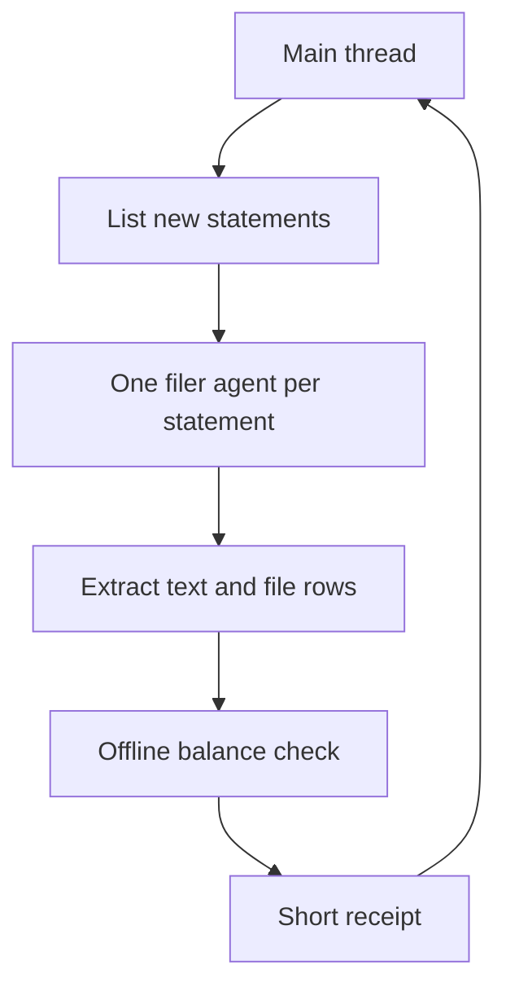

# How I write skills

> Eight patterns that recur across the skills and agents in this repo, each with a short example quoted from a published file.

These patterns came from failures, not from a plan. Each one is a rule I added after a run went wrong, and the dates in the files show when.

## 1. A description that states the trigger

Claude Code decides whether to load a skill from its description. I write the description as a list of the moments that should trigger it, in the words a person would actually use.

> "Use when the user says "/wrapup", "wrap up", "save this session", or before ending a session whose knowledge must not wait for auto-capture." ([wrapup](../skills/wrapup/SKILL.md))

## 2. Golden rules first

The rules that came from bugs go at the top, and a subagent is told to read them before it does anything else. A cheaper model then inherits the lessons without having to find them again.

> "Golden rules (distilled bug history — filer agents MUST read and obey)" ([mm-file](../skills/mm-file/SKILL.md))

The filer agent opens with the same instruction: read the skill fully, because the golden rules there override anything else ([mm-filer](../agents/mm-filer.md)). The wrapup skill does the same with its cost rules: "read first, they are the whole point" ([wrapup](../skills/wrapup/SKILL.md)).

## 3. A verification step that proves the result

A skill ends with a check whose output decides the result. An agent's statement that the work is done is not enough.

> "Verify every time — via DB download, NEVER via HTTP row-sums" ([mm-file](../skills/mm-file/SKILL.md))

The balance check over HTTP gave false failures, including a phantom large negative gap on one card. A recompute from a downloaded copy of the database showed every card 0.00 off. The filer must now pass within 1 rupee of the printed amount due, and [`verify_db.py`](../skills/mm-file/scripts/verify_db.py) carries a `--demo` self-check on synthetic rows.

A check must also fail loudly. The wiki-maintainer agent records why: a silenced index update "made a broken index look exactly like a healthy one", and the retrieval benchmark went 18 days without running while wrapups reported success ([wiki-maintainer](../agents/wiki-maintainer.md)).

## 4. Dated corrections kept in the file

When a rule turns out wrong, I correct it in place and keep a short dated note of what was wrong. The next reader then knows the old belief existed and why it was dropped.

> "the old "delete API is fake, UI only" note was wrong" ([mm-file](../skills/mm-file/SKILL.md), verified 2026-08-22)

The note stays short. One project page grew to 28 KB because every correction appended a warning block instead of editing the claim, so the wrapup skill now says: correct the claim in place, leave one short dated note, and put the story in the append-only log.

## 5. Cost rules with measured numbers

A cost rule without a number gets ignored. The first rules in the wrapup skill start from a measurement.

> "Two wrapups on 2026-08-02 cost ~187k tokens between them." ([wrapup](../skills/wrapup/SKILL.md))

The causes are listed in order, and the first carries its size: reading the append-only log to check a heading format cost about 30k tokens. A later step adds that a subagent sent to file work the session had already filed would spend 80-100k tokens finding those edits again. The recall skill does the same for search: "always cap — default 20 burns ~10x tokens" ([recall](../skills/recall/SKILL.md)).

## 6. A thin main thread, one subagent per unit of work

The main thread orchestrates and never does the heavy reading. Each unit of work, such as one statement or one research subtopic, goes to its own subagent with a throwaway context, often on a cheaper model, and comes back as a short receipt.

> "Main thread (any model): orchestrate only. Never open a PDF, never read MM XML, never drive a browser. ~200 tokens per statement." ([mm-file](../skills/mm-file/SKILL.md))

The filer agent runs on Sonnet with a short tool list, and its whole final message is a receipt of at most 10 lines ([mm-filer](../agents/mm-filer.md)). The earlier version did all of this in one chat and used up a whole session's usage limit. The research skill follows the same rule: "Research agents do the reading; main thread only sees synthesis." ([deep-research](../skills/deep-research/SKILL.md))

## 7. A human choice gate

Where only a person can decide, the skill stops and asks instead of going ahead.

> "Do not start building until the user approves the plan." ([deep-research](../skills/deep-research/SKILL.md))

The same gate appears elsewhere: the research skill asks its scoping questions in one batch before any search, and the filing skill asks before it categorises an app-store charge, because that merchant name does not say what was bought.

## 8. Saying what a measurement cannot prove

A passing check proves only what it measures. The skills say where that line is, so that nobody reads a green line as more than it is.

> "its OK does **not** mean the knowledge base's map is current" ([wrapup](../skills/wrapup/SKILL.md))

That line is about the gate's viewer-rebuild step, which redraws the graph viewer from whatever the graph file holds. On 2026-10-04 a wrapup reported the knowledge base updated while the map was 9 days and 14 files behind, and I caught it. The filing skill does the same for its balance check: some non-zero results are correct, so the script prints CHECK and a person confirms them. The research skill asks for every unverified assumption to be stated in the deliverable, at the point where it matters.

## Limits

These patterns come from one person's setup, and the numbers were measured by me on my own data. They show what worked for me, not a tested method for a team. Claude Code wrote most of the files under my direction; the rules, the pass bars and the decisions are mine.
